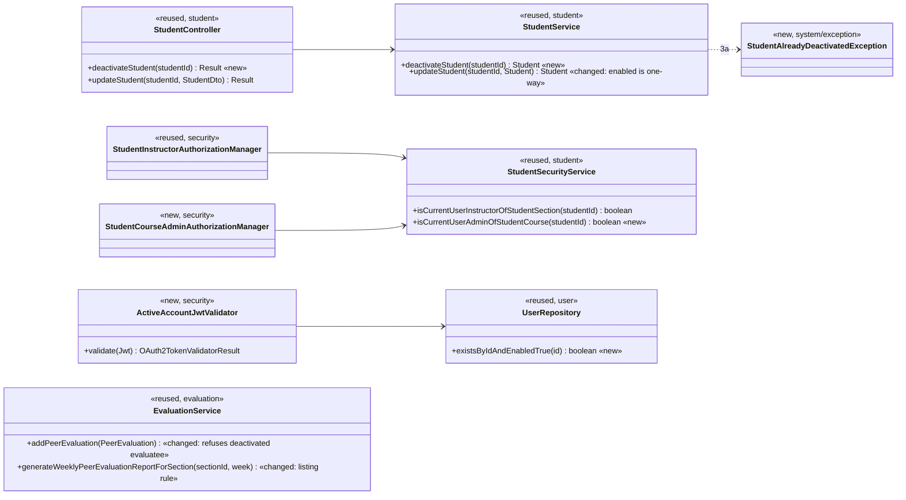
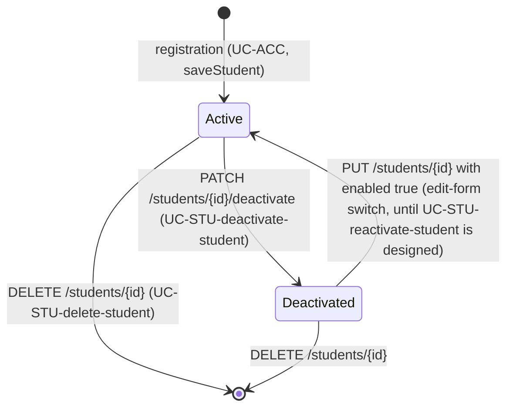

# Student (STU) Design

> Realizes: UC-STU-deactivate-student
> Depends on: FR-SEC-active-account, BR-student-lifecycle, BR-deactivated-not-evaluated, BR-submission-owed, BR-section-scoped-access, CO-ferpa
> See: [use cases](../requirements/use-cases.md#student), [business rules](../requirements/business-rules.md), [SRS security requirements](../requirements/software-requirements-specification.md), [architectural-design.md](architectural-design.md#shared-foundation-components) (shared foundation component view, [Security & Compliance](architectural-design.md#security--compliance))
> Designed against `main` at `59f0267` (2026-11-04).

## Overview

This area covers a student's account within her course section. The other STU use cases (invite, find, view, delete) were built before this spec set existed and are mapped in `../traceability.md`. This doc starts with **UC-STU-deactivate-student**. It lives in the foundation's `student` package (see the [shared foundation component view](architectural-design.md#shared-foundation-components)), and its effects reach `security` (enforcing an open session) and `evaluation` (BR-deactivated-not-evaluated).

Before this design, the only way to deactivate a student was the **Status** switch in the edit-student form, which sends a generic `PUT /students/{id}`. That path had no consequence warning and no confirmation, and it reported success when nothing changed. Deactivation was enforced only at login, so a student who was already logged in kept access for the rest of her 2-hour token. A course admin not assigned to the student's course section was refused, contrary to BR-student-lifecycle. Teammates were still asked to rate her.

**Out of scope:** UC-STU-reactivate-student is not designed. Until it is, the edit form's Status switch is the reactivation path, and this design narrows that switch so it can only turn an account **on**.

## Components & classes



Backend files:
- `backend/src/main/java/team/projectpulse/student/StudentController.java`, `StudentService.java`, `StudentSecurityService.java`: reused, with the methods above added or changed.
- `backend/src/main/java/team/projectpulse/security/authorizationmanagers/StudentCourseAdminAuthorizationManager.java`: new thin wrapper over `isCurrentUserAdminOfStudentCourse`. `StudentInstructorAuthorizationManager.java`: reused.
- `backend/src/main/java/team/projectpulse/security/ActiveAccountJwtValidator.java`: new. Wired in `SecurityConfiguration.jwtDecoder()` next to the default validators.
- `backend/src/main/java/team/projectpulse/user/UserRepository.java`: one derived query added.
- `backend/src/main/java/team/projectpulse/system/exception/StudentAlreadyDeactivatedException.java`: new, mapped to `409` in `ExceptionHandlerAdvice`.
- `backend/src/main/java/team/projectpulse/evaluation/EvaluationService.java`: two methods changed.
- `notification/SubmissionStatusService.java`: **unchanged**. It already counts only active teammates as ones a student owes an evaluation of (BR-submission-owed), which agrees with BR-deactivated-not-evaluated.

Frontend files:
- `frontend/src/apis/student/index.ts`: new `deactivateStudent(id)`.
- `frontend/src/pages/students/EditStudentForm.vue`: for an active student, the Status switch is replaced by an `Active` tag and a **Deactivate** button that opens the confirmation dialog. For a deactivated student, the switch remains and can only turn the account on.
- `frontend/src/pages/students/Students.vue`: status tags read `Active` / `Deactivated` (the use case's vocabulary), not `Enabled` / `Disabled`.
- `frontend/src/pages/evaluations/SubmitTeamsEvaluations.vue`: hides teammates whose `enabled` is `false`.

## Sequence

### UC-STU-deactivate-student: deactivate a student

```mermaid
sequenceDiagram
    autonumber
    actor U as Course admin / instructor
    participant V as EditStudentForm.vue
    participant SEC as SecurityConfiguration<br/>anyOf(StudentInstructorAM, StudentCourseAdminAM)
    participant C as StudentController
    participant S as StudentService
    participant DB as MySQL (users)
    U->>V: open the student's details (steps 1-2, UC-STU-view-student)
    U->>V: choose Deactivate (step 3)
    V->>U: confirmation dialog stating the consequences (step 4)
    alt 5a cancel
        U->>V: Cancel
        Note over V: no request is sent; the student is unchanged
    else confirm (step 5)
        V->>SEC: PATCH /students/{studentId}/deactivate
        alt 3b caller is neither the course admin nor an assigned instructor
            SEC-->>V: 403 (BR-student-lifecycle)
        else authorized
            SEC->>C: deactivateStudent(studentId)
            C->>S: deactivateStudent(studentId)
            alt 3a already deactivated
                S-->>V: 409, "already deactivated"; the view reloads
            else active
                S->>DB: enabled = false (course section and team untouched)
                C-->>V: 200, StudentDto with enabled false
                V->>U: "The student has been deactivated" (step 6); the list reloads
            end
        end
    end
```

### After deactivation: the open session and peer evaluations

```mermaid
sequenceDiagram
    actor St as Deactivated student (token still unexpired)
    actor Tm as Teammate
    participant D as JwtDecoder + ActiveAccountJwtValidator
    participant F as SubmitTeamsEvaluations.vue
    participant E as EvaluationService
    St->>D: any request under the API base URL (Bearer token)
    D->>D: default checks (signature, expiry), then existsByIdAndEnabledTrue(userId claim)
    D-->>St: 401 (FR-SEC-active-account); the SPA clears the token and shows login, where the disabled account is refused again
    Tm->>F: open the peer evaluation form
    F->>F: GET /students/teams/{teamId}, then drop teammates with enabled false
    Tm->>E: POST /evaluations naming her as evaluatee (crafted request)
    E-->>Tm: 400 (BR-deactivated-not-evaluated)
    Note over E: an evaluation of her submitted before deactivation is still editable until its window closes
    Note over E: the section report lists her for a week only if she received at least one evaluation that week
```

### Account state



## API contract

| Endpoint or job | Caller (who may) | Request | Success | Errors, by extension |
|---|---|---|---|---|
| `PATCH /students/{studentId}/deactivate` (new) | The course admin of the student's course, or an instructor assigned to her course section | path `studentId`; no body | `200`, the updated `StudentDto` (`enabled: false`) | 3a already deactivated → `409`; 3b any other caller, including the student herself, → `403`; an id that names no student → `403` (the route rule refuses before the service runs) |
| `PUT /students/{studentId}` (changed) | unchanged | unchanged | unchanged | an instructor changing `enabled` from true to false → `400`, pointing to the Deactivate action; false to true is still accepted |
| `POST /evaluations` (changed) | unchanged | unchanged | unchanged | the evaluatee is deactivated → `400` (BR-deactivated-not-evaluated) |
| section peer evaluation report, `EvaluationController.generateWeeklyPeerEvaluationReportForSection` (changed) | unchanged | unchanged | lists every active student on a team; lists a deactivated student only if she received at least one peer evaluation that week | — |
| every request carrying a Bearer token (changed) | — | — | — | the account behind the token is deactivated or no longer exists → `401` (FR-SEC-active-account) |

## Key decisions

- **A dedicated deactivate endpoint, not the generic `PUT`.** The generic update has no confirmation step (step 4), cannot report 3a, and lets an unrelated field edit deactivate a student by accident. *Rejected:* adding a confirmation dialog in front of the existing `PUT`. Any other client of the `PUT` would still bypass it. The endpoint style follows `PATCH /teams/{teamId}/section`.
- **The generic `PUT` can only turn `enabled` on.** Every deactivation goes through the confirmed path, and the switch remains the reactivation path until UC-STU-reactivate-student is designed. *Rejected:* leaving the switch two-way and recording the bypass as debt.
- **Authorization is `anyOf(StudentInstructorAuthorizationManager, StudentCourseAdminAuthorizationManager)`.** That is exactly BR-student-lifecycle's "course admin, or an instructor assigned to the student's course section". `isCurrentUserAdminOfStudentCourse` follows `student.section.course.courseAdmin` and returns `false` for anything it cannot resolve. *Rejected:* reusing `UserOwnershipAuthorizationManager` (which guards the other `/students/{studentId}` routes). It admits the student herself and refuses a course admin who is not assigned to the course section. The path carries a single id and the route rule resolves it, so the service's `findById` needs no further scoping.
- **3a returns `409`, not an idempotent `200`.** Step 6 tells the user the student "has been deactivated", and reporting that for a no-op would hide a stale view. *Rejected:* an idempotent success.
- **An open session is ended by a JWT validator that checks the account on every request.** `ActiveAccountJwtValidator` runs after the default signature and expiry checks and calls `existsByIdAndEnabledTrue` with the token's `userId` claim. That is one primary-key lookup per authenticated request. A failure takes the existing invalid-bearer-token path to `401`, and the SPA already turns a `401` into a return to login. This makes FR-SEC-active-account hold for tokens issued before deactivation, and it narrows TD-jwt-revocation for deactivated accounts. *Rejected:* accepting up to 2 hours of continued access, which violates the FR. Also rejected: checking only in the WAR and peer evaluation submission paths, which leaves reads and other writes open. A revocation list or token version would be the general fix for TD-jwt-revocation and is more than this use case needs.
- **She keeps her course section and team** (BR-student-lifecycle). Her reports and received peer evaluations stay attached to the team they were written for, and reactivation needs no reassignment. *Rejected:* removing her from her team on deactivation.
- **"Not evaluated" is enforced in `EvaluationService.addPeerEvaluation`, and the form only hides her.** *Rejected:* filtering deactivated students out of `GET /students/teams/{teamId}` on the server. Instructor team views use the same endpoint and must still list her.
- **Editing an evaluation of her that was submitted before deactivation stays allowed** (`updatePeerEvaluation` unchanged). It is part of the record, and the submission window closes it within the week (BR-deactivated-not-evaluated, BR-evaluation-editable-until-close). *Rejected:* refusing edits as well. Confirmed with the developer.
- **The report's listing rule reuses the evaluations the report already loads.** `getPeerEvaluationAverage` already fetches her evaluations for the week, so a deactivated student with none is dropped without an extra query.

## Data model

No delta. `PeerEvaluationUser.enabled` (the `users` table) already carries the account state; see the SRS Business Domain Model. No Flyway migration.

## Reuse & cross-cutting

- **Authorization:** the existing route-rule plus `*SecurityService` pattern and the `AuthorizationManagers.anyOf` combination used by the reminders routes ([Authorization](architectural-design.md#security--compliance)).
- **Authentication:** the existing JWT resource-server chain. The validator adds a check and no new mechanism.
- **Who owes a submission:** BR-submission-owed in `notification/SubmissionStatusService` already excludes deactivated students, as owers and as teammates owed an evaluation. No change.
- **Email:** none. The use case sends no notification on deactivation.

## Tests

| Use case, flow | Level | Asserts |
|---|---|---|
| UC-STU-deactivate-student main: an instructor assigned to the course section deactivates an active student | integration (`StudentIntegrationTest`) | `200`; `enabled` is false; her course section and team are unchanged; her next login is `401` |
| main: the course admin of the student's course, not assigned to her course section, deactivates | integration | `200` (needs seed data for such an admin, or a test fixture that builds one) |
| main, FR-SEC-active-account: the student's token issued before deactivation | integration | `GET /students/{her id}` and `POST /activities` with that token → `401` |
| 3a already deactivated | unit (`StudentServiceTest`) and integration | `StudentAlreadyDeactivatedException` / `409`; state unchanged |
| 3b caller not permitted (BR-student-lifecycle) | integration | a plain instructor not assigned to her course section → `403`; the student herself → `403`; an id naming no student → `403` |
| 5a cancel | Cypress (`students.spec.cy.js`, API stubbed) | Cancel sends no `PATCH`; Confirm sends exactly one |
| generic `PUT` is one-way | unit and integration | an instructor changing `enabled` true → false gets `400` and the student stays active; false → true gets `200` |
| validator | unit (`ActiveAccountJwtValidatorTest`) | active account → success; deactivated or missing account → failure |
| BR-deactivated-not-evaluated: new evaluation of a deactivated teammate | unit (`EvaluationServiceTest`) and integration | `400` and nothing saved; the same evaluator rating an active teammate → `200` |
| BR-deactivated-not-evaluated: edit of an evaluation submitted before deactivation | unit | `updatePeerEvaluation` succeeds inside the window |
| BR-deactivated-not-evaluated: form | Cypress (`peerevalutions.spec.cy.js`, API stubbed) | a teammate with `enabled: false` is not rendered; active teammates are |
| BR-deactivated-not-evaluated: section report | unit (`EvaluationServiceTest`) and integration | active with no evaluations that week → listed; deactivated with none → absent; deactivated with at least one → listed |
| BR-submission-owed agreement | existing `SubmissionStatusServiceIntegrationTest` | still passes with no change |

## Open questions / risks

- After the `401`, the login page shows the generic "User account is abnormal." for a deactivated account. The message is left as is.
- The per-request check adds one indexed lookup to every authenticated request. That is negligible at this scale; if it ever shows up in profiling, cache it briefly with a short TTL.
